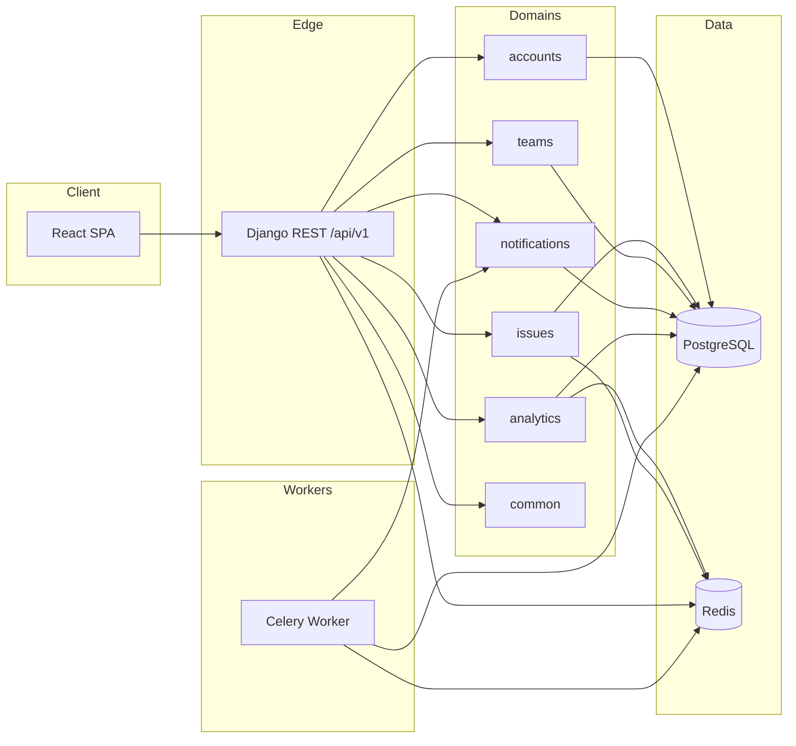
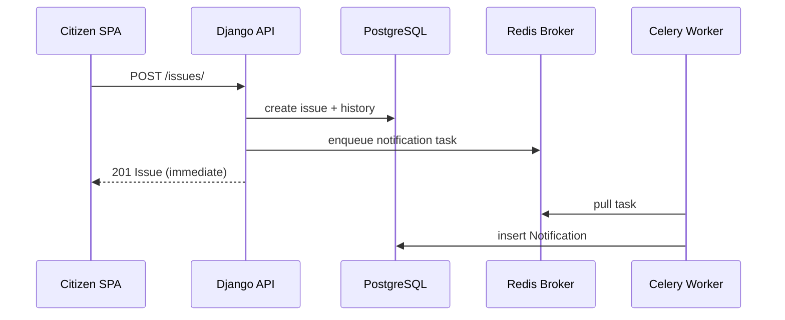

# CityFix Architecture

## Style: Modular Monolith

CityFix ships as a **single deployable Django application** partitioned into domain modules. This is intentional for a college MVP: one process to run and reason about, clear seams for later extraction.



## Component responsibilities

| Module | Responsibility |
|--------|----------------|
| `accounts` | Custom User, JWT login/register, roles |
| `issues` | Reporting, duplicates, lifecycle, priority, images, supports |
| `teams` | Maintenance teams and assignments |
| `notifications` | In-app notification model + Celery tasks |
| `analytics` | Dashboard aggregation, cache helpers, system health |
| `common` | Pagination, permissions, exception shape, timing middleware |
| `config` | Settings, URLs, Celery app |

## Layering inside `issues`

```
views (HTTP) → serializers (validation) → services (use-cases)
                                         → lifecycle / duplicates / priority
                                         → models (persistence)
```

Views stay thin. Domain rules (transitions, duplicate scoring, assignment locking) live in dedicated modules so they can be tested and explained without the HTTP layer.

## Request vs background flow



## Why not microservices yet?

- Shared transactional needs (assign = assignment + status + history)
- Single team / evaluation environment
- Operational overhead of Kafka/K8s is unjustified for MVP

Each app (`issues`, `notifications`, …) maps to a future service boundary if load or ownership requires it. See [SCALABILITY.md](SCALABILITY.md).
