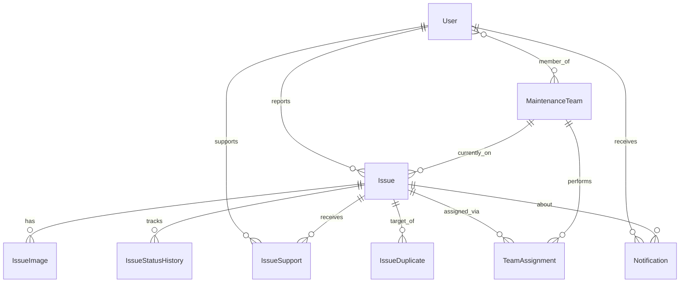

# Database Design

## ER diagram

## Core tables

### `accounts_user`
Extends Django AbstractUser with `role` (`CITIZEN` | `ADMIN` | `MAINTENANCE`).

### `issues_issue`
- `public_id` UUID (external identifier)
- Geo: `latitude`, `longitude`, `address`
- `status`, `priority`, `priority_score`, `support_count`
- FKs: `reporter`, `assigned_team`

### `issues_issueimage`
Evidence / completion images with `kind`.

### `issues_issuestatushistory`
Immutable audit of transitions.

### `issues_issuesupport`
Unique `(issue, user)`.

### `issues_issueduplicate`
Candidate/confirmed links with score breakdown.

### `teams_maintenanceteam` / `teams_teamassignment`
Partial unique: one **active** assignment per issue.

### `notifications_notification`
In-app inbox rows.

## Indexes and why they exist

| Index | Optimizes |
|-------|-----------|
| `issue_status_priority_idx` | Admin queues: open + high priority |
| `issue_category_status_idx` | Dashboards + duplicate category narrowing |
| `issue_reporter_created_idx` | Citizen “my issues” |
| `issue_lat_lng_idx` | Bounding-box prefilter for duplicates |
| `issue_team_status_idx` | Maintenance workload |
| `status_hist_issue_time_idx` | Timeline fetch |
| `unique_issue_support` | Prevent double-support |
| `unique_active_assignment_per_issue` | Concurrency safety |
| `notif_recipient_read_idx` | Unread inbox |

## Normalization notes

- Images are separate (1:N) to avoid bloating issue rows and to allow multiple evidence kinds.
- Status history is append-only (no update-in-place of past states).
- Support count is denormalized on `Issue` for list sorting; updated inside the support transaction.
