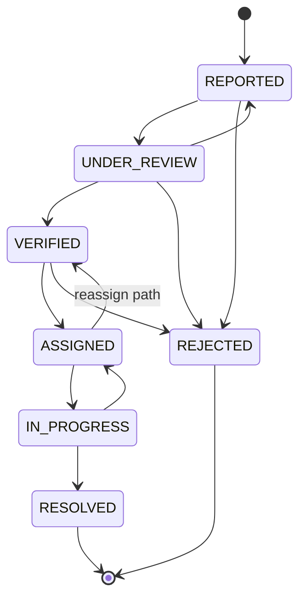
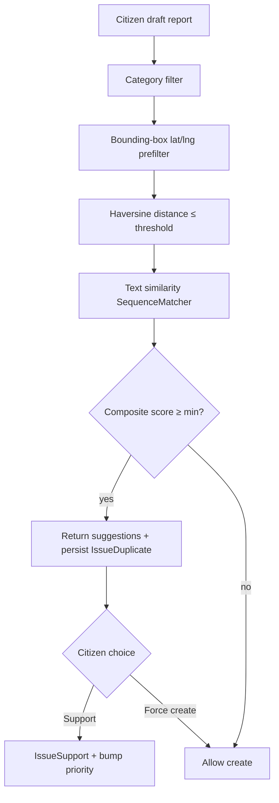
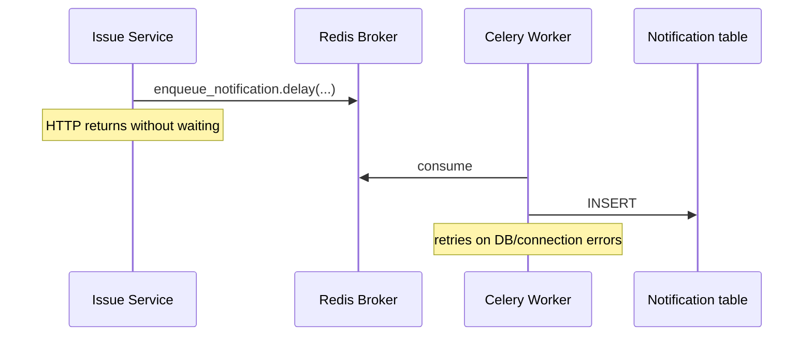

# System Design — HLD, LLD, Trade-offs

## High-level design

CityFix is a **BFF-less modular monolith**: the React SPA talks directly to versioned REST APIs. PostgreSQL is the system of record; Redis is used for **cache** (DB 0) and **Celery broker/results** (DB 1/2).

### Issue lifecycle



Every transition writes `IssueStatusHistory` (previous, new, actor, timestamp, comment). Invalid edges raise validation errors.

### Duplicate detection flow



### Asynchronous notifications



## Low-level design highlights

### Priority scoring (deterministic)

```
score = w_s * severity + w_u * supportCurve + w_a * ageCurve + w_c * categoryWeight
```

Mapped to LOW / MEDIUM / HIGH / CRITICAL. Weights live in environment variables for evaluation tweaks without code changes.

### Concurrency on assignment

1. `Issue.objects.select_for_update()` serializes concurrent admin assigns
2. Deactivate prior active `TeamAssignment`
3. Insert new active row
4. Partial unique constraint `unique_active_assignment_per_issue` as a safety net
5. Status history written in the same `transaction.atomic()`

### Caching strategy

| Key | TTL | Invalidated when |
|-----|-----|------------------|
| `analytics:dashboard_stats` | 60s | Issue create/update/assign/resolve/support |
| `analytics:public_stats` | 60s | Same |

**Not cached:** per-user issue lists, mutations, auth — stale personalized data is worse than a few ms of query time.

Cache hit/miss logged via `cityfix.cache` logger and counters exposed on System Health.

### Fault behavior

| Dependency | Failure mode |
|------------|--------------|
| PostgreSQL | API errors; health shows `down` |
| Redis cache | `IGNORE_EXCEPTIONS` + try/except → compute uncached; requests continue |
| Celery/Redis broker | API still returns; notifications delayed; task retries with backoff when broker recovers |
| Celery worker stopped | Tasks queue in Redis; process when worker returns |

## Trade-offs

| Decision | Benefit | Cost |
|----------|---------|------|
| Modular monolith | Simple ops, ACID across domains | Scale-out is vertical first |
| Sync duplicate check | Better UX at submit time | Adds latency (~tens of ms) |
| Haversine vs PostGIS | Zero geo extension setup | Less efficient at huge scale |
| In-app notifications only | Demonstrates async without SMTP | No email proof in MVP |
| Partial unique + row lock | Strong assignment integrity | Slightly longer lock duration |

## Evolution path

1. Extract `notifications` worker service (already Celery-isolated)
2. Add PostGIS + trigram indexes for city-scale duplicates
3. Read replicas for analytics queries
4. Optional: move duplicate scoring to async with websocket suggestion delivery
